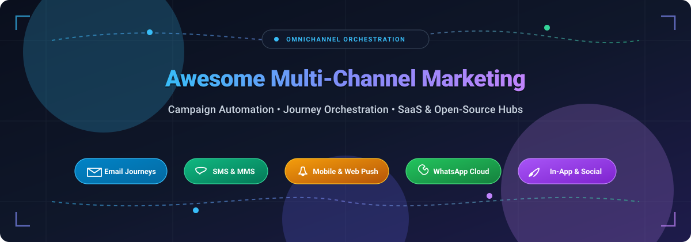

  

# 🚀 Awesome Multi-Channel Marketing Campaigns & Orchestration

  
  
  
  
  
  
  

> 🎯 A curated list of top **Multi-Channel Marketing Campaign** and **Omnichannel Marketing Orchestration** platforms — featuring enterprise SaaS solutions (with detailed pricing 💵, free tier limits 🎁, and company scale 🏢) and top open-source self-hosted alternatives for running automated email ✉️, SMS 💬, mobile push 🔔, WhatsApp 📱, and social campaigns 🌐 from a unified platform.
>
> 🌟 **Star this repo if you find it useful!** 🌟

---

## 📋 Table of Contents

- [📈 Sector Overview & Market Dynamics](#-sector-overview--market-dynamics)
- [🟦 SaaS / Hosted Platforms](#-saas--hosted-platforms)
- [🟩 Open-Source Software](#-open-source-software)
- [📊 Comparison at a Glance](#-comparison-at-a-glance)
- [🛠 Key Architectural Considerations](#-key-architectural-considerations)
- [🤝 Contributing](#-contributing)
- [💖 Support & Community](#-support--community)
- [⭐ Star History](#-star-history)
- [📄 License](#-license)

---

## 📈 Sector Overview & Market Dynamics

The global Multichannel Marketing Hubs (MMH) and marketing automation market is valued at approximately **$6.4 billion** 📊 and is projected to expand past **$13.5 billion by 2032** 🚀, maintaining a compound annual growth rate (CAGR) of **~8.7%** 📈. 

The sector is **highly fragmented** 🧩: while enterprise cloud incumbents (Adobe Marketo, HubSpot, Salesforce) command major market revenue, no single provider controls a winner-take-all monopoly due to rapid specialization across product-led growth ⚡, e-commerce behavioral triggers (Klaviyo) 🛍️, developer-centric notification engines 📬, and privacy-focused open-source alternatives 🛡️.

---

## 🟦 SaaS / Hosted Platforms

Commercial, cloud-hosted multi-channel marketing hubs and orchestration platforms. Sorted by company size (valuation / market capitalization, descending 📉):

| 🏢 Platform | 💰 Company Size (Valuation / Market Cap) | 🏷️ Starting Tier Pricing | 🎁 Free Tier / Free Trial Limits | ⚡ Key Capabilities |
| :--- | :--- | :--- | :--- | :--- |
| **[HubSpot Marketing Hub](https://www.hubspot.com/products/marketing)** | ~$28B – $32B Market Cap (NYSE: HUBS) 🌐 | **$20/month** (Starter tier, billed monthly; $15/mo billed annually) for up to 1,000 marketing contacts | **Free Forever plan**: Capped at 2,000 marketing email sends/month, up to 2 users, 10 active lists, and basic single-step form follow-ups (mandatory HubSpot branding) | All-in-one inbound marketing, native CRM integration, forms, landing pages, email marketing, and automated nurture workflows. |
| **[Mailchimp](https://mailchimp.com/)** | $12B Valuation (Acquired by Intuit, NASDAQ: INTU) 📦 | **$13/month** (Essentials tier) for up to 500 contacts and 5,000 email sends/month | **Free Forever plan**: Limited to 250 contacts, 500 email sends/month (max 250 sends/day), 1 audience, 1 user seat, and 30 days of email support (no automated journeys or scheduling) | Widely adopted email marketing platform expanded into SMS, social advertising, landing pages, and basic behavioral customer journeys. |
| **[Klaviyo](https://www.klaviyo.com/)** | ~$6.1B Market Cap (NYSE: KVYO) 📈 | **$20/month** (Email tier) for up to 500 active profiles and 5,000 email sends/month | **Free Forever plan**: Up to 250 active profiles, 500 email sends/month, $5 in mobile SMS/MMS credits, 3 active automated flows, and 1 live sign-up form | High-throughput e-commerce customer data platform (CDP) and automated marketing engine with deep Shopify, WooCommerce, and BigCommerce sync. |
| **[Marketo Engage](https://business.adobe.com/products/marketo/adobe-marketo.html)** | $4.75B Valuation (Acquired by Adobe, NASDAQ: ADBE) 🏛️ | **~$900 – $1,250/month** (Growth tier, billed annually at ~$10,000 – $15,000/year; quote-based) | **No Free Tier or Self-Serve Trial**: Available exclusively via scheduled enterprise sales demos; sandbox testing requires a negotiated enterprise contract | Enterprise B2B marketing automation, complex multi-touch lead scoring, revenue attribution, account-based marketing (ABM), and Salesforce sync. |
| **[ActiveCampaign](https://www.activecampaign.com/)** | $3B Valuation (Series C Post-Money Valuation) 🚀 | **$15/month** (Starter tier, billed annually) for up to 1,000 contacts | **14-Day Free Trial**: Includes full Professional-tier features, 1 user seat, and up to 100 total outbound test emails (no credit card required) | Advanced visual workflow automation, event tracking, dynamic segmentation, integrated sales CRM, email marketing, and SMS orchestration. |
| **[Brevo](https://www.brevo.com/)** | ~$750M+ Total Funding / Growth-Stage Leader 🌟 | **$9/month** (Starter tier) for 5,000 emails/month with no daily send limits | **Free Forever plan**: Up to 300 emails/day (~9,000 emails/month), unlimited contact storage (up to 100k contacts), 1 user seat, and automations for up to 2,000 contacts | Multi-channel communication suite supporting email campaigns, transactional messaging, SMS, WhatsApp marketing, web chat, and light CRM. |

---

## 🟩 Open-Source Software

Self-hosted, community-driven, and developer-first marketing automation platforms. Sorted by GitHub star count (descending ⭐):

| 📦 Project | ⭐ Stars | 💻 Tech Stack | 📜 License | 📝 Description & Use Case |
| :--- | :---: | :--- | :--- | :--- |
| **[Novu](https://github.com/novuhq/novu)** |  | TypeScript, Node.js, React, Redis, MongoDB | MIT | Open-source notification infrastructure and workflow orchestration engine. Coordinates multi-channel notifications across Email, SMS, In-App feeds, Push (FCM/APNS), and Chat (Slack, Discord) with digest engines and fallback routing. |
| **[Chatwoot](https://github.com/chatwoot/chatwoot)** |  | Ruby on Rails, Vue.js, PostgreSQL, Redis | AGPL-3.0 | Self-hosted customer engagement suite and live chat platform. Enables conversational outbound marketing and proactive customer support across Website live chat, WhatsApp, SMS, Email, and social channels. |
| **[Listmonk](https://github.com/knadh/listmonk)** |  | Go, PostgreSQL, Vue.js | AGPL-3.0 | Ultra-fast, lightweight newsletter and mailing list manager packaged as a single binary. Handles millions of subscribers and high-volume email campaigns with custom JSON attributes, SQL segmentation, and transactional REST APIs. |
| **[Mautic](https://github.com/mautic/mautic)** |  | PHP (Symfony), MySQL / MariaDB | GPL-3.0 | The most established open-source marketing automation platform. Provides visual customer journey builders, multi-channel messaging (Email, SMS, Web Push), contact lead scoring, dynamic web tracking, and GDPR consent management. |
| **[Mailtrain](https://github.com/Mailtrain-org/mailtrain)** |  | Node.js, MySQL / MariaDB | GPL-3.0 | Self-hosted email newsletter application built on top of Nodemailer. Supports large subscriber lists, custom form fields, click tracking, trigger-based drip automations, and GPG encryption for subscriber data. |
| **[Plunk](https://github.com/useplunk/plunk)** |  | TypeScript, Next.js, PostgreSQL, Redis, AWS SES | AGPL-3.0 | Modern, open-source email marketing and automation platform. Combines transactional emails, marketing broadcasts, event-triggered automations, and an AI-ready Model Context Protocol (MCP) server on top of Amazon SES. |
| **[Dittofeed](https://github.com/dittofeed/dittofeed)** |  | TypeScript, Node.js, PostgreSQL, ClickHouse, Temporal | MIT | Modern omni-channel customer engagement platform built as an open-source alternative to Customer.io, OneSignal, and Braze. Features DAG-based visual journeys, event streaming, and multi-channel delivery (Email, SMS, WhatsApp, Push). |
| **[Laudspeaker](https://github.com/laudspeaker/laudspeaker)** |  | TypeScript, Node.js, PostgreSQL, Redis | Open Source / Apache-2.0 | Y Combinator-backed customer engagement and journey automation engine designed to replace Braze and Iterable. Supports event-triggered multi-channel messaging (Email, SMS, Push, Slack) and native PostHog analytics integration. |
| **[Keila](https://github.com/pentacent/keila)** |  | Elixir (Phoenix LiveView), PostgreSQL | AGPL-3.0 | Lightweight, privacy-respecting newsletter and email campaign platform. Offers clean markdown/visual block template editing, contact tag segmentation, sign-up forms, and zero tracking pixels by default. |
| **[SendPortal](https://github.com/mettle/sendportal)** |  | PHP (Laravel), MySQL / PostgreSQL | MIT | Open-source email marketing software for managing subscribers, segments, and multi-ESP email campaigns. Integrates seamlessly with AWS SES, SendGrid, Postmark, Mailgun, and Mailjet. |
| **[Helio](https://github.com/achref-soua/helio)** |  | TypeScript, Temporal, PostgreSQL, ClickHouse | AGPL-3.0 | AI-native open-source growth platform and CDP. Features React Flow journey building compiled to Temporal workflows, multi-channel messaging (Email, SMS via Twilio, WhatsApp, Web Push), and local/cloud LLM copilot agents. |
| **[ReachHub](https://github.com/susheelhbti/ReachHub)** |  | PHP (Laravel), MySQL | Open Source | Developer-friendly multi-channel marketing package supporting drip workflows, WhatsApp Cloud API, SMS, Push notifications, and local LLM content adaptation via Ollama. |

---

## 📊 Comparison at a Glance

| 🛠️ Solution | 🌐 Deployment | ✉️ Email | 💬 SMS / WhatsApp | 🔔 Web / Mobile Push | 🚀 Social / Chat | 🔀 Visual Journey Builder | 🎯 Primary Focus |
| :--- | :--- | :---: | :---: | :---: | :---: | :---: | :--- |
| **HubSpot** | Cloud SaaS ☁️ | ✅ | Add-on | ❌ | ✅ | ✅ | Enterprise inbound sales & CRM marketing |
| **Mailchimp** | Cloud SaaS ☁️ | ✅ | ✅ | ❌ | ✅ | ✅ | SMB & creator email/SMS marketing |
| **Klaviyo** | Cloud SaaS ☁️ | ✅ | ✅ | ✅ | ❌ | ✅ | E-commerce behavioral retention |
| **Marketo** | Cloud SaaS ☁️ | ✅ | Add-on | ❌ | Add-on | ✅ | B2B lead scoring & ABM orchestration |
| **ActiveCampaign** | Cloud SaaS ☁️ | ✅ | ✅ | ❌ | ❌ | ✅ | SMB/mid-market behavioral workflow automation |
| **Brevo** | Cloud SaaS ☁️ | ✅ | ✅ | ✅ | ✅ | ✅ | Budget-friendly multi-channel marketing |
| **Novu** | Self-Hosted / Cloud ⚡ | ✅ | ✅ | ✅ | ✅ | ✅ | Developer-first multi-channel notification engine |
| **Chatwoot** | Self-Hosted / Cloud ⚡ | ✅ | ✅ | ❌ | ✅ | ❌ | Omnichannel conversational customer support |
| **Listmonk** | Self-Hosted 🏠 | ✅ | ❌ | ❌ | ❌ | ❌ | High-throughput, self-hosted newsletter campaigns |
| **Mautic** | Self-Hosted 🏠 | ✅ | ✅ | ✅ | Plugins | ✅ | Full-scale open-source marketing automation |
| **Mailtrain** | Self-Hosted 🏠 | ✅ | ❌ | ❌ | ❌ | Drip | Self-hosted bulk email lists & automations |
| **Plunk** | Self-Hosted / Cloud ⚡ | ✅ | ❌ | ❌ | ❌ | ✅ | Modern AWS SES-backed email engine & AI agent API |
| **Dittofeed** | Self-Hosted / Cloud ⚡ | ✅ | ✅ | ✅ | ✅ | ✅ | Git-friendly, Temporal-backed customer journeys |
| **Laudspeaker** | Self-Hosted / Cloud ⚡ | ✅ | ✅ | ✅ | ✅ | ✅ | Open-source alternative to Braze & Customer.io |
| **Keila** | Self-Hosted / Cloud ⚡ | ✅ | ❌ | ❌ | ❌ | ❌ | Simple, privacy-first email newsletters (Elixir) |
| **SendPortal** | Self-Hosted 🏠 | ✅ | ❌ | ❌ | ❌ | ❌ | Laravel-based multi-ESP email campaign manager |
| **Helio** | Self-Hosted 🏠 | ✅ | ✅ | ✅ | ❌ | ✅ | AI-native CDP & workflow orchestration |
| **ReachHub** | Self-Hosted 🏠 | ✅ | ✅ | ✅ | ❌ | ✅ | Laravel & WhatsApp multi-channel drip campaigns |

---

## 🛠 Key Architectural Considerations

When choosing or deploying a multi-channel campaign solution:

1. **Email Delivery Infrastructure (MTA vs. ESP API) 📨:** Self-hosted platforms (like Listmonk, Plunk, Mautic, and SendPortal) do not deliver mail directly to consumer inboxes on their own. They require relaying through transactional SMTP or REST APIs like **Amazon SES**, **SendGrid**, **Postmark**, or **Mailgun** to ensure high deliverability, SPF/DKIM validation, and bounce management.
2. **State & Workflow Durability ⏱️:** Modern tools like **Dittofeed** and **Helio** leverage workflow orchestrators like **Temporal** to maintain long-running user journeys (e.g., waiting 3 days between steps) reliably through server restarts and failures.
3. **Data Sovereignty & Privacy (GDPR/HIPAA) 🔒:** Self-hosting tools like Mautic or Listmonk allows businesses to retain complete ownership of user PII without exporting sensitive contact records to third-party US cloud providers.

---

## 🤝 Contributing

Contributions are welcome! 🌟 If you know of an outstanding open-source Multi-Channel Marketing Campaign tool that should be included:

1. 🍴 Fork this repository.
2. 📝 Add the tool to the appropriate tables with accurate license, tech stack, and GitHub star badge.
3. 🚀 Submit a pull request detailing the project and why it stands out.

Please ensure added repositories are actively maintained (commits within the last 12 months) and open-source.

---

## 💖 Support & Community

Thank you for exploring this curated collection! If you find this repository valuable:
- ⭐ **Star** this repository to help others discover it!
- 🍴 **Fork** it and contribute new tools, updates, and case studies.
- 📢 **Share** it with your fellow engineers, marketers, and solopreneurs!
- ☕ **Buy a coffee & sponsor**: If this project saves you time or helps your stack, consider supporting future maintenance via the [GitHub Sponsor Dashboard](https://github.com/sponsors/ishandutta2007).

---

##  Star History

---

## 📄 License

This repository and curated list are released under the [Creative Commons Zero v1.0 Universal (CC0-1.0)](http://creativecommons.org/publicdomain/zero/1.0/) license. Individual products, software projects, and logos belong to their respective copyright holders.

---

⭐ **If this list helped you find the right marketing orchestration stack, please star the repo!** ⭐
